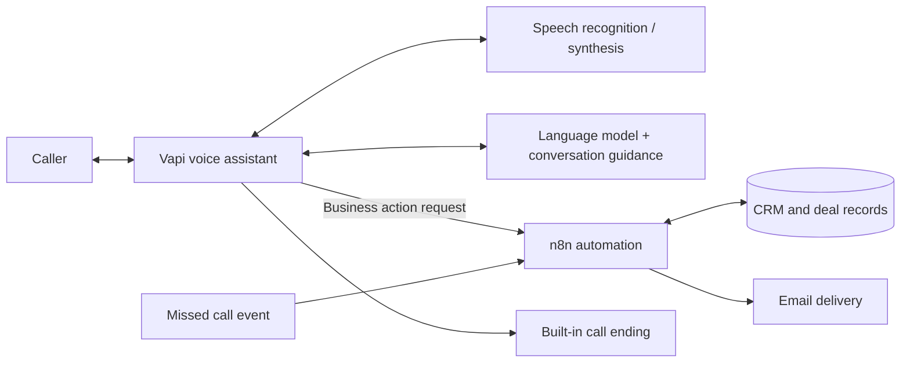

# Nexus AI — Conversational Voice Assistant & Workflow Automation

**Portfolio case study | Vapi · Speech AI · GPT · n8n · Airtable · SMTP**

A real-estate buyer-support voice assistant designed to handle common inquiries, capture buyer preferences, retrieve property information, and initiate follow-ups. This repository demonstrates the **automation patterns and engineering decisions**, using **sanitized, importable n8n example workflows**—not the company's deployable production system.

> **Publication review required:** The business, metrics, and original workflow logic are connected to employer work. Confirm permission to publish before setting the repository public. No customer-level call data, raw agent prompt, Vapi tool definitions, access credentials, production account IDs, or active webhook URLs are included.

## Business challenge

A small team needs to respond to buyer questions while keeping buyer records, deal lookups and follow-up requests consistent. Manual handoffs can lead to duplicate information, missing context and delayed next actions.

## Solution at a glance

*Conceptual diagram only; not a copy of the production topology or tool schema.*

## Voice-agent prompt design — what I added and why

I developed and refined conversation guidance in Vapi. Instead of publishing the full prompt, this is a **design overview**:

| Design area | What I introduced | Why it matters |
| --- | --- | --- |
| Identity and scope | A consistent, professional buyer-support persona and clear task boundaries | Keeps interactions focused on the business use case |
| Guided intake | One-question-at-a-time information gathering with confirmation of contact details | Reduces misunderstanding before CRM updates |
| Deal discovery | City-driven queries and concise presentation of a single matching listing | Makes retrieval easy to follow over a phone call |
| Permission-based follow-up | Offer to send a property link and check prerequisites first | Avoids unexpected emails and missing-record errors |
| Human handoff | Recognize callback requests and record them for the team | Makes escalation an explicit business action |
| Buyer education and boundaries | Plain-English explanations, clear AI identity, and no financial promises | Improves clarity without overstating what the agent knows |
| Conversational polish | Brief, natural phrasing; silence handling guidance; graceful wrap-up | Improves the caller experience |

These are **prompt design intentions**, not proof that each behavior was enforced in production. Specific system instructions and Vapi tool configurations are intentionally withheld.

## Backend workflows

The six JSON files in [`workflows/`](workflows/) are **sanitized adaptations** derived from workflow exports. They retain node types, processing steps, and connections for technical review, but replace external-account references and remove credentials and internal metadata.

| Example workflow | Automation concept |
| --- | --- |
| [`buyer-intake.json`](workflows/buyer-intake.json) | Data mapping and conditional create/update behavior |
| [`property-search.json`](workflows/property-search.json) | City normalization, data filtering, and voice-friendly response formatting |
| [`callback-request.json`](workflows/callback-request.json) | Phone normalization, buyer lookup, and callback flagging |
| [`property-email.json`](workflows/property-email.json) | Buyer/deal lookup followed by email delivery |
| [`call-logging.json`](workflows/call-logging.json) | End-of-call event handling and logging fields |
| [`missed-call-trigger.json`](workflows/missed-call-trigger.json) | Inbound event routing to a voice-call API |

The assistant's **built-in call-ending action** is distinct from these n8n workflows. The included JSON files are **not configured to connect to any real accounts** and are not an end-to-end deployment. Importing requires isolated test credentials, mock tables, and review of expression behavior.

## My contributions

- Worked on voice-agent conversation guidance and tool-triggered buyer journeys.
- Built and debugged webhook mappings, city-based property searches, buyer intake, callback flags and property-email actions.
- Traced integration issues across voice interactions, n8n executions and Airtable data handoffs.
- Designed an initial KPI framework for buyer engagement and lead-follow-up visibility; **the analytics proposal is not claimed as a deployed dashboard**.

## Aggregate project outcomes (publish only with approval)

- **100+ automated customer calls**, reported in internal project summary.
- **Approximately 80%** ended **without the caller requesting a human representative**; this is **not** a measured issue-resolution or sales-conversion rate.

No individual transcript, recording, call summary, phone number or customer record is contained in this repository.

## Engineering lessons and boundaries

The workflow exports show areas that merit validation in a test environment, including no-match branches, Airtable formula correctness, result ordering, record ID propagation, and confirmation of email delivery. This repository does **not** claim all illustrative examples are production-tested or bug-free.

See [review notes](docs/technical-review.md) and [publishing guidance](PUBLISHING.md).
